<div align="center">



### All of Higgsfield inside Claude. Ask for the piece and it ships.

Image, video, audio, 3D, ads, UGC, characters, presets, editing, websites and publishing:<br>
one agent and 17 skills that drive the **Higgsfield** MCP for you.

**[Install](#install)** · **[What it is](#what-it-is)** · **[What's inside](#whats-inside)** · **[Costs](#costs-and-limits)** · **[Español](README.md)**

</div>

<br>

> The skills are written in Spanish and answer in the user's language. Prompts sent to Higgsfield are always written in English.

## Install

Inside Claude Code:

```text
/plugin marketplace add Hainrixz/higgsfield-studio
/plugin install higgsfield-studio@higgsfield-studio
```

Restart the Claude Code session, then ask for something:

```text
make a product image for Instagram from this photo
```

### Connect Higgsfield

The plugin ships no server of its own. It uses the official Higgsfield MCP with your account (you need credits; browser sign-in, no API keys).

```bash
claude mcp add --transport http --scope user higgsfield https://mcp.higgsfield.ai/mcp
```

Then `/mcp` → `higgsfield` → authenticate. On claude.ai or the desktop app: Settings → Connectors → Add custom connector → name `Higgsfield`, URL `https://mcp.higgsfield.ai/mcp`.

## What it is

Higgsfield exposes about 150 MCP tools. Without guidance Claude has to guess which one to call, in what order, with which model, and how to wait for the result. Higgsfield Studio gives it that craft:

- **It generates.** Asking for the piece is the authorization. The cost is stated in one line and the work continues.
- **Live catalog.** Models, presets and workflows are read from Higgsfield on every job, so the plugin does not go stale when a new model lands.
- **Zero hooks.** Nothing intercepts tool calls. The money rules live in the `estudio` skill, where you can read and change them.
- **Alone or together.** Each skill works on its own. The agent chains them when a job has several steps.

## What's inside

One agent, `higgsfield-studio`, and 17 skills:

| Skill | What it covers |
|---|---|
| `estudio` | The core: connection, uploads, cost, waiting and delivery. Every other skill loads it first. |
| `imagen` | Text to image, reference editing, typography, native GIF and SVG, thumbnails. |
| `video` | Text to video, multi-shot, start and end frames, narrated and faceless videos. |
| `animar` | Image to video, motion transfer, object replacement inside a video. |
| `audio` | Speech, music, dubbing, voice cloning and voice change, lipsync. |
| `producto` | Catalog and campaign shots from your real product photo. |
| `anuncios` | Ads Studio end to end, micro-drama ads, Ad Multiplier, borrowing the structure of a competitor ad. |
| `ugc` | A person talking to camera about your product. |
| `personajes` | The same face across every piece: Soul, reference elements, AI Influencer. |
| `presets` | Viral templates, Genjutsu, Katana, Shorts and explainers. |
| `editar` | Upscale, outpaint, reframe to 9:16, background removal, montage and color. |
| `tres-d` | Image to 3D model with rig and animation, and 3D scenes. |
| `web-y-juegos` | Websites, apps and games. |
| `publicar` | Publish to TikTok and publish projects. |
| `analizar` | Video breakdown and virality prediction. |
| `cuenta` | Balance, transactions, projects and folders. |
| `direccion-de-arte` | Eleven prompt blocks so the image looks like a campaign, not stock. |

The full tool map by area is in [`docs/herramientas.md`](docs/herramientas.md).

## Costs and limits

Generating through the Higgsfield MCP **spends credits from your plan**.

- When a price can be checked without generating, the plugin states it in one line and continues.
- If you set a cap or ask it to confirm before spending, it does.
- If the balance is short, it says so and gives you the top-up link.

It stops only where it has to: when Higgsfield itself asks a question (for example unlimited generations versus credits), at the Ads Studio price quote, and before publishing, deleting, training a character or cloning a voice you did not ask for.

It never buys credits, changes your plan, turns on unlimited or free generations by itself, publishes or deletes unasked, generates extra variants, resubmits after a network error without knowing whether the first call went through, or invents a price or a metric.

## Maintenance

```bash
node scripts/validar.mjs
```

Checks the manifests, every skill's frontmatter, and that each tool named in a skill exists in `scripts/herramientas.txt`.

## Credits

Made by [Enrique Rocha](https://tododeia.com) for the Todo de IA community.

Higgsfield Studio is an independent project. It is not affiliated with or endorsed by Higgsfield.

## License

[MIT](LICENSE) © 2026 Enrique Rocha
