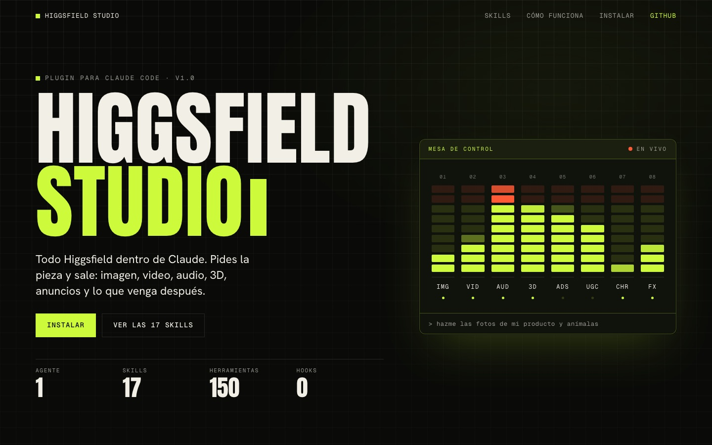

<div align="center">



### Todo Higgsfield dentro de Claude. Pides la pieza y sale.

Imagen, video, audio, 3D, anuncios, UGC, personajes, presets, edición, webs y publicación:<br>
un agente y 17 skills que manejan el MCP de **Higgsfield** por ti.

[](CHANGELOG.md)
[](https://code.claude.com/docs/en/plugins)
[](LICENSE)
[](#qué-incluye)
[](#costos-y-límites)

**[Instalar](#instalación)** · **[Qué es](#qué-es)** · **[Qué incluye](#qué-incluye)** · **[Uso](#uso)** · **[Costos](#costos-y-límites)** · **[English](README.en.md)**

</div>

<br>

## Instalación

Dentro de Claude Code, dos comandos:

```text
/plugin marketplace add Hainrixz/higgsfield-studio
/plugin install higgsfield-studio@higgsfield-studio
```

O desde la terminal:

```bash
claude plugin marketplace add Hainrixz/higgsfield-studio
claude plugin install higgsfield-studio@higgsfield-studio
```

Reinicia la sesión de Claude Code y pide algo:

```text
hazme una imagen de producto para Instagram con esta foto
```

### Conectar Higgsfield

El plugin no trae servidor propio: usa el MCP oficial de Higgsfield con tu cuenta (necesitas créditos; inicio de sesión en el navegador, sin llaves que copiar).

<details>
<summary><b>En Claude Code</b></summary>

```bash
claude mcp add --transport http --scope user higgsfield https://mcp.higgsfield.ai/mcp
```

Luego `/mcp` → `higgsfield` → autenticar.

</details>

<details>
<summary><b>En claude.ai o la app de escritorio</b></summary>

Ajustes → Conectores → Añadir conector personalizado → nombre `Higgsfield`, URL `https://mcp.higgsfield.ai/mcp` → Conectar.

Un conector añadido en claude.ai también aparece en Claude Code con la misma cuenta.

</details>

<details>
<summary><b>Instalar desde una copia local</b></summary>

```bash
git clone https://github.com/Hainrixz/higgsfield-studio.git
claude plugin marketplace add ./higgsfield-studio
claude plugin install higgsfield-studio@higgsfield-studio
```

</details>

Para comprobar que todo quedó, pregunta: `¿cuántos créditos de Higgsfield me quedan?`

## Qué es

Higgsfield tiene unas 150 herramientas por MCP. Sin guía, Claude tiene que adivinar cuál usar, en qué orden, con qué modelo y cómo esperar el resultado. Higgsfield Studio le da ese oficio:

- **Genera directo.** Pedir la pieza es la autorización. El costo se dice en una línea y el trabajo sigue.
- **Catálogo en vivo.** Los modelos, plantillas y flujos se leen del propio Higgsfield en cada trabajo, así que no envejece cuando sale un modelo nuevo.
- **Cero hooks.** Nada intercepta las llamadas. Las reglas de dinero están escritas en la skill `estudio`, donde puedes leerlas y cambiarlas.
- **Suelto o junto.** Cada skill funciona sola. El agente las encadena cuando el encargo tiene varios pasos.

<div align="center">
<a href="docs/index.html"></a>
</div>

## Qué incluye

Un agente, `higgsfield-studio`, que parte el encargo en pasos, y 17 skills:

| Skill | Para qué |
|---|---|
| `estudio` | El núcleo: conexión, subir archivos, costo, esperar y entregar. Las demás la cargan primero. |
| `imagen` | Texto a imagen, edición con referencia, tipografía, GIF y SVG nativos, miniaturas. |
| `video` | Texto a video, varias tomas, fotogramas de inicio y fin, videos narrados o sin rostro. |
| `animar` | Imagen fija a video, copiar un movimiento, cambiar un objeto dentro de un video. |
| `audio` | Voz, música, doblaje, clonar o cambiar una voz, lipsync. |
| `producto` | Fotos de catálogo y de campaña desde la foto real de tu producto. |
| `anuncios` | Ads Studio completo, micro-dramas, multiplicar un anuncio, tomar la estructura de uno ajeno. |
| `ugc` | Una persona hablando a cámara de tu producto. |
| `personajes` | El mismo rostro en todas tus piezas: Soul, elementos de referencia, AI Influencer. |
| `presets` | Plantillas virales, Genjutsu, Katana, Shorts y explainers. |
| `editar` | Escalar, ampliar el encuadre, pasar a 9:16, quitar fondo, montar y dar color. |
| `tres-d` | De imagen a modelo 3D con rig y animación, y escenas 3D. |
| `web-y-juegos` | Sitios, apps y juegos. |
| `publicar` | Subir a TikTok y publicar proyectos. |
| `analizar` | Desglose de un video y predicción de viralidad. |
| `cuenta` | Saldo, movimientos, proyectos y carpetas. |
| `direccion-de-arte` | Once bloques para que el prompt salga de campaña y no de banco de imágenes. |

El mapa completo de herramientas por área está en [`docs/herramientas.md`](docs/herramientas.md).

## Uso

Pide en tus palabras. Algunos ejemplos:

| Dices | Qué pasa |
|---|---|
| "Hazme la miniatura de este video" | `imagen` genera con el modelo por defecto y te la entrega. |
| "Fotos de mi producto en fondo blanco y una de campaña" | `producto` sube tu foto y trabaja desde el producto real. |
| "Anima esta foto y pásala a 9:16" | `animar` y luego `editar`. |
| "Un anuncio para TikTok de esta URL" | `anuncios` arma marca y producto en Ads Studio, te cotiza y genera. |
| "Dobla este video al inglés" | `audio`. |
| "Convierte este personaje en 3D" | `tres-d`. |
| "¿Qué efectos virales hay?" | `presets` te los muestra; no ejecuta nada hasta que elijas. |
| "Súbelo a mi TikTok" | `publicar` prepara el envío; el botón final lo aprietas tú (en claude.ai o la app, no en terminal). |
| "¿Cuántos créditos me quedan?" | `cuenta`. |

Para encargos de varios pasos, pídelo entero y el agente lo encadena:

```text
hazme las fotos de mi producto, anima la mejor, ponle voz en español y déjala en 9:16
```

Los resultados se descargan a `salidas/<fecha>-<nombre>/` junto con un `prompts.md` que guarda el prompt, el modelo y los créditos gastados.

## Costos y límites

Generar con Higgsfield por MCP **gasta créditos de tu plan**. El plugin lo trata así:

- Si el precio se puede consultar sin generar, te lo dice en una línea y sigue.
- Si le pones un tope ("no gastes más de 50 créditos") o le pides confirmar antes, lo respeta.
- Si no alcanza el saldo, te lo dice y te da el enlace de recarga.

Se detiene solo donde hace falta:

- Cuando el propio Higgsfield pregunta algo, por ejemplo si usar generaciones ilimitadas o créditos.
- En Ads Studio, que pide tu sí al precio cotizado antes de generar.
- Antes de publicar, borrar, entrenar un personaje o clonar una voz, si no lo pediste.

### Lo que nunca hace

- Comprar créditos ni cambiar tu plan.
- Activar generaciones ilimitadas o gratis por su cuenta.
- Publicar o borrar sin que lo pidas.
- Generar variantes o tandas que no pediste.
- Reenviar una generación tras un error de red sin saber si la primera se lanzó.
- Inventar un precio o una métrica.

## Mantenimiento

```bash
node scripts/validar.mjs
```

Comprueba los manifiestos, el frontmatter de cada skill y que toda herramienta citada exista en `scripts/herramientas.txt`. Si Higgsfield cambia una herramienta, se actualiza esa lista y el validador señala qué skill tocar.

<details>
<summary><b>Estructura del repo</b></summary>

```text
.claude-plugin/     plugin.json, marketplace.json
agents/             higgsfield-studio.md
skills/             17 carpetas, cada una con SKILL.md y references/
docs/               index.html, styles.css, herramientas.md
assets/             banner.svg, home-hero.jpg
scripts/            validar.mjs, herramientas.txt
```

</details>

## Créditos

Hecho por [Enrique Rocha](https://tododeia.com) para la comunidad de Todo de IA.

Higgsfield Studio es un proyecto independiente. No está afiliado a Higgsfield ni respaldado por ellos; "Higgsfield" es marca de su titular.

## Licencia

[MIT](LICENSE) © 2026 Enrique Rocha

<!-- marca-agua:inicio -->

---

<sub>Hecho por **Enrique Rocha (@soyenriquerocha)** · [tododeia.com](https://www.tododeia.com)⁠​‌‌​​‌​‌​‌‌‌​​‌​​​‌​‌‌​‌​‌‌​​​​‌​‌‌​​‌​​​​‌‌​‌​‌​‌‌​​‌​‌​​‌‌​​​​​​‌‌‌​​‌​​‌‌​​​‌​​‌‌​‌‌‌⁠</sub>
<!-- marca-agua:fin -->
